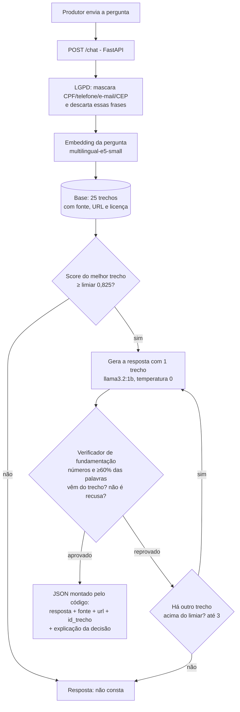
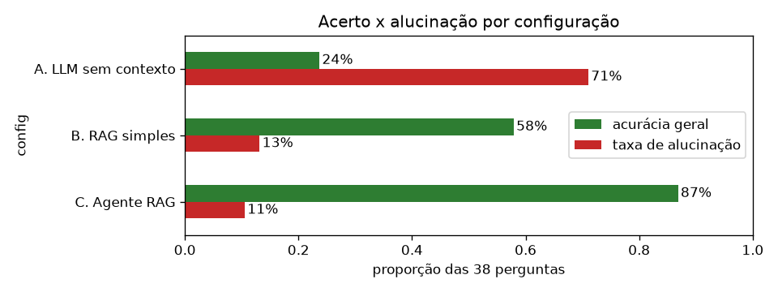

# AgroConecta IA: Generative AI for Engineering

Assistente com **LLM local** (`llama3.2:1b` via Ollama) e **RAG** que responde dúvidas de pequenos produtores rurais sobre **energia** e **mobilidade/escoamento da produção**, sempre **citando a fonte oficial** e respondendo **"não consta"** quando a base não cobre a pergunta.

> Resultado principal (38 perguntas, mesmo modelo nas três configurações): o **Agente RAG** acerta **87%**, contra **58%** do RAG simples e **24%** do modelo sem contexto. Nas 10 perguntas fora do escopo, ele **recusou as 10** e não inventou nenhum dado.

---

## 01. Integrantes

| Nome completo | RM |
|---|---|
| Eric de Carvalho Rodrigues | RM550249 |
| Renato Izumi Ichikawa | RM99242 |
| Bernardo Pinto Rocha | RM99209 |

## 02. Ficha técnica

| Item | Descrição |
|---|---|
| **Produto** | AgroConecta Assistant |
| **Cidadão e território** | Pequenos produtores e agricultura familiar, inclusive em áreas com pouca conectividade |
| **Problema** | Falta de informação confiável sobre **energia** (geração solar, desconto de irrigação, Luz para Todos, crédito Pronaf, biodigestor, bombeamento) e sobre **escoamento da produção** (perdas no transporte, venda para PNAE/PAA, cadeia do leite). Isso encarece a produção e gera desperdício. |
| **O que a IA resolve** | Responde perguntas em linguagem simples, com base em **25 trechos de fontes oficiais** (leis, ANEEL/MME, Embrapa, MAPA, FNDE). Toda resposta traz fonte e link, e a IA diz "não consta" quando não sabe. |
| **Problema do desafio** | Energia + mobilidade |
| **Arquitetura** | FastAPI → agente RAG → busca vetorial (`intfloat/multilingual-e5-small`) → LLM local (`llama3.2:1b` no Ollama) → verificador de fundamentação |
| **Especialização** | **Agente** (não LoRA), com ciclo *buscar → gerar → verificar → corrigir* |
| **Privacidade (LGPD)** | Tudo roda local; dados pessoais da pergunta são mascarados e descartados antes da LLM; o log não grava perguntas |
| **ODS** | ODS 2 (Fome Zero e Agricultura Sustentável), ODS 7 (Energia Limpa e Acessível), ODS 13 (Ação Climática) |

## 03. Diagrama do pipeline de IA



Os documentos de origem (PDF/HTML de órgãos oficiais e da Embrapa) foram lidos e **parafraseados em trechos curtos e autocontidos** em [`base/conhecimento.json`](base/conhecimento.json). Cada trecho tem `id`, `tema`, `titulo`, `texto`, `fonte`, `url` e `licenca`.

## 04. Base de conhecimento

| Fonte | Formato original | Licença | Trechos (ids) |
|---|---|---|---|
| Lei 14.300/2022 (marco legal da geração distribuída) | HTML (Senado) | Ato oficial, domínio público (Lei 9.610/98, art. 8º, IV) | 3 (1–3) |
| ANEEL REN 1.000/2021, desconto de irrigação (via CNA) | HTML | Ato oficial; texto da CNA parafraseado com citação | 1 (4) |
| Folha de Pernambuco: percentuais do desconto de irrigação | HTML (notícia) | Parafraseado com citação | 1 (5) |
| CNA/Famato: requisitos do desconto | HTML | Parafraseado com citação | 1 (6) |
| Portaria Normativa MME 137/2026 | PDF | Ato oficial, domínio público | 1 (7) |
| Decreto 11.628/2023 (Luz para Todos) | HTML (Câmara) | Ato oficial, domínio público | 1 (8) |
| Decreto 12.964/2026 (altera o Luz para Todos) | HTML (Senado) | Ato oficial, domínio público | 1 (9) |
| MDA: resumo das linhas do Pronaf | PDF | Publicação governamental, parafraseada | 2 (10–11) |
| Embrapa Agroenergia, Documentos 55 (biodigestor) | PDF | Acesso aberto, parafraseado com citação | 2 (12–13) |
| Embrapa Clima Temperado, Documentos 443 (fotovoltaica) | PDF | Acesso aberto, parafraseado com citação | 1 (14) |
| Embrapa Instrumentação, Documentos 58 (irrigador solar) | PDF | Acesso aberto, parafraseado com citação | 1 (15) |
| Embrapa Hortaliças, Luengo et al. 2001 (perdas pós-colheita) | PDF | Acesso aberto, parafraseado com citação | 3 (16–18) |
| Embrapa, Moretti 2008 (boas práticas pós-colheita) | PDF | Acesso aberto, parafraseado com citação | 1 (19) |
| Lei 11.947/2009, art. 14 (PNAE) | HTML (Planalto) | Ato oficial, domínio público | 1 (20) |
| FNDE (chamada pública do PNAE) + Lei 14.660/2023 | PDF | Ato oficial, domínio público | 1 (21) |
| Lei 14.628/2023 + Decreto 11.802/2023 (PAA) + Lei 15.178/2025 | HTML (Câmara) | Ato oficial, domínio público | 2 (22–23) |
| MAPA, Instrução Normativa 77/2018 (leite) | PDF | Ato oficial, domínio público | 1 (24) |
| Secretaria de Agricultura de SP, IEA AIA 50/2019 (IN 76/77) | PDF | Publicação governamental, parafraseada | 1 (25) |
| **Total** | | | **25 trechos** (15 de energia, 10 de mobilidade) |

**Conjunto de teste** ([`avaliacao/testes.json`](avaliacao/testes.json)): 38 perguntas escritas como um produtor falaria. São **28 respondíveis**, com gabarito, id do trecho correto e palavras-chave, e **10 "não consta"**. Várias "não consta" são propositalmente parecidas com a base, como preço de painel solar, taxa de juros do Pronaf, kg por caixa K e biogás por vaca.
**Conjunto de calibração** ([`avaliacao/calibracao.json`](avaliacao/calibracao.json)): 15 perguntas **separadas do teste**, usadas só para escolher o limiar.

## 05. Performance do modelo

Todos os números abaixo saem de [`notebooks/pipeline_rag.ipynb`](notebooks/pipeline_rag.ipynb), que está salvo com as saídas, e ficam gravados em `avaliacao/`.

### Busca: Recall@1 e Recall@3 (28 perguntas respondíveis)

| Modelo de embeddings | Recall@1 | Recall@3 |
|---|---|---|
| `all-MiniLM-L6-v2` (versão anterior do projeto, treinado em inglês) | 71,4% | 92,9% |
| `paraphrase-multilingual-MiniLM-L12-v2` | 71,4% | 96,4% |
| **`intfloat/multilingual-e5-small`** (escolhido) | **96,4%** | **100%** |

O E5 multilíngue entende português de verdade. O único erro de top-1 (T23, licitação no PNAE) cai no trecho vizinho do mesmo assunto (20 em vez de 21).

### Limiar de recusa: 0,825

O limiar foi escolhido no **conjunto de calibração**, varrendo valores de 0,80 a 0,93 ([`avaliacao/limiar.csv`](avaliacao/limiar.csv)). Na calibração, o maior score de uma pergunta fora do escopo foi **0,824**, e o menor de uma respondível foi **0,831**. Com 0,825, a decisão responder/recusar acerta **100%** da calibração. Entre os limiares empatados, escolhemos o **menor**: é melhor deixar o verificador barrar uma resposta duvidosa do que recusar uma pergunta válida.

Aplicado ao teste, o porteiro sozinho acerta **82%** das decisões. Ele barra 3 das 10 perguntas fora do escopo e não barra nenhuma respondível. As 7 restantes são justamente as "parecidas com a base" e foram barradas pela segunda camada, o verificador.

### Placar das três configurações (38 perguntas)



| Métrica | A. LLM sem contexto | B. RAG simples | **C. Agente RAG** |
|---|---|---|---|
| **Acurácia geral** | 23,7% | 57,9% | **86,8%** |
| Acerto nas respondíveis (28) | 17,9% | 46,4% | **82,1%** |
| Recusa correta nas "não consta" (10) | 40,0% | 90,0% | **100%** |
| **Taxa de alucinação** | 71,1% | 13,2% | **10,5%** |
| Recusa indevida (respondível recusada) | 7,1% | 39,3% | **3,6%** |
| JSON válido | n/a | n/a | **100%** |
| Citação do trecho correto | n/a | n/a | **92,6%** |

- **A. LLM sem contexto:** o `llama3.2:1b` puro alucina em 27 das 38 perguntas. Ele inventa prazos, valores e leis com toda a confiança (exemplos na seção abaixo). Prova que o modelo, sozinho, não serve para o produtor.
- **B. RAG simples:** colocar o trecho no prompt derruba a alucinação de 71% para 13%. Em compensação, o modelo 1B "foge" demais: com a instrução "se não estiver no texto, diga não consta", ele recusou **11 das 28** perguntas que o trecho respondia.
- **C. Agente RAG:** mantém a alucinação baixa e resolve as recusas indevidas (39% → 4%), porque a decisão de recusar sai do modelo 1B e vai para regras verificáveis (porteiro + verificador). Nas perguntas fora do escopo, nenhuma resposta passou. Os 4 erros restantes são **respostas incompletas ou com a citação trocada**, não dados inventados (seção 06).

**Por que agente e não LoRA:** com 25 trechos, um LoRA no modelo 1B tenderia a decorar o texto e continuaria sem uma forma de **provar** de onde veio a resposta. O agente dá controle explícito: limiar justificado, verificação de cada resposta contra a fonte, citação montada pelo código e explicação de cada decisão (campo `explicacao` da API). O LoRA fica como trabalho futuro, combinado com o agente.

**Como a correção é feita:** a resposta é correta se contém as palavras-chave do gabarito. Numa pergunta "não consta", só a recusa conta como acerto. A correção é automática e conservadora; todas as 114 respostas estão em [`avaliacao/respostas.csv`](avaliacao/respostas.csv) para conferência manual.

### Demonstração de alucinações (config A, mesmo modelo sem contexto)

| Pergunta | Fonte oficial (gabarito) | LLM sem contexto respondeu |
|---|---|---|
| Por quanto tempo valem os créditos da energia solar? | 60 meses (Lei 14.300/2022) | "têm um prazo de validade de **25 anos**" |
| Qual o limite anual do PAA-Leite por família? | R$ 30 mil (Decreto 11.802/2023) | "**R$ 1.500,00**" e chamou o PAA-Leite de "Alimentação Animal para Animais Livres" |
| Com que temperatura máxima o leite pode chegar no laticínio? | 7 °C (IN 76/77 MAPA) | "temperaturas máximas de **40 °C**" |
| Quanto da merenda escolar deve ir para a agricultura familiar? | mínimo de 30% (Lei 11.947/2009) | citou a **Lei 8.666/1993** (lei de licitações) |
| Melhor variedade de milho para o cerrado? (fora do escopo) | não consta | inventou a variedade "**Cenarim-1**" |
| Biogás por dia com 10 vacas? (fora do escopo) | não consta | B, mesmo com contexto: "**1.000 a 1.500 litros**"; C recusou porque o verificador barrou os números ausentes do trecho |

## 06. Os 5 erros do agente, a causa e a correção proposta

Estes são os 5 erros que **sobraram na versão final** do agente (C), tirados de [`avaliacao/erros.csv`](avaliacao/erros.csv).

| # | Pergunta | O que aconteceu | Causa | Correção proposta |
|---|---|---|---|---|
| 1 | T17: Que bomba usar para bombear água com energia solar? | Respondeu só "bombas de **diafragma**"; o trecho cita **pistão e diafragma** | O 1B resume listas e corta itens. O verificador checa se o que foi dito está no trecho, mas não percebe o que **faltou** | Verificação de completude (termos do trecho que casam com a pergunta precisam aparecer na resposta); pedir "liste todos os itens"; testar `llama3.2:3b` |
| 2 | T04: Existe desconto na luz para quem irriga? | Respondeu "Sim" e citou a REN 1.000, mas **omitiu a condição** (8h30 diárias, horário noturno) | Mesma causa: resposta correta porém incompleta, e a condição é o que o produtor precisa saber | Prompt com estrutura fixa ("resposta + condições/limites"); a mesma verificação de completude |
| 3 | T12: Tem crédito para comprar painel solar? | O modelo disse que o trecho certo (Pronaf Bioeconomia) **não respondia** e acabou citando o trecho 11, com uma resposta vaga | Falso negativo do 1B: não ligou "painel solar" a "sistemas de energia solar". O agente confia na recusa do modelo | Não aceitar recusa do modelo quando o score é alto (por exemplo, > 0,90) e insistir uma vez; incluir sinônimos no trecho ("painéis solares") |
| 4 | T23: Preciso de licitação para vender para a merenda? | Conclusão certa ("não precisa"), mas **citou o trecho 20** (30% do PNAE) em vez do 21 (chamada pública) | Erro de busca: os dois trechos do PNAE são muito parecidos (é o único erro de Recall@1) | Reranker (cross-encoder) sobre o top-3, ou escolher, entre os trechos aprovados, o de maior cobertura da pergunta; ou juntar os trechos 20 e 21 |
| 5 | T14: Dá para usar esterco das vacas para fazer gás? | **Recusou** ("não consta") uma pergunta respondível | O modelo parafraseou e o verificador mediu cobertura de **56%**, abaixo do corte fixo de **60%**. A pergunta fala "esterco", o trecho fala "dejetos" | Calibrar `min_cobertura` no conjunto de calibração (hoje é fixo); somar à checagem lexical uma similaridade semântica (embedding) entre resposta e trecho; lista de sinônimos do campo |

### Erros encontrados durante o desenvolvimento (já corrigidos)

O histórico completo, com os números de cada rodada, está em [`avaliacao/historico/README.md`](avaliacao/historico/README.md).

| Erro | Correção aplicada |
|---|---|
| O notebook antigo tinha `SyntaxError` (string `f"""` nunca fechada) e estava **sem saídas** | Notebook reescrito, executado de ponta a ponta e salvo com as saídas (`scripts/rodar_notebook.py`) |
| Com "se não souber, diga não consta", o 1B sem contexto **recusou 38 de 38** perguntas | Baseline A virou o modelo puro, o que mede a alucinação real |
| Modo `format: json` no 1B: JSON dentro de string, campos inventados (`"beneficiários": "0"`) e, às vezes, **espaços sem parar até o timeout** | O modelo gera texto; o **código monta o JSON** (100% válido) e anexa a fonte; `num_predict=200` |
| Agente v1 (top-3 numerados e recusa a cargo da LLM): **57% de recusas indevidas** e respostas como `"[10]"` | Um trecho por vez; recusa por regras (porteiro + verificador) |
| Ao reenviar com feedback, o modelo passou a **copiar o trecho** em perguntas fora do escopo e "passava" no verificador | Nova tentativa só quando a resposta veio vazia ("Sim."); reprovação por número ou cobertura vai direto para o próximo trecho |
| Recusas disfarçadas ("Não encontrei informações...") eram tratadas como resposta | Detector de recusa (`eh_recusa`), usado pelo agente e pela correção |
| Os marcadores `[CPF]`/`[TELEFONE]` na pergunta confundiam o 1B | Minimização: as frases com dado pessoal são descartadas antes da LLM |
| Embeddings em inglês com Recall@1 de 71% | Troca para `multilingual-e5-small` (96,4%) |

## LGPD, segurança e explicabilidade

- **Processamento 100% local:** embeddings e LLM rodam na máquina; a pergunta não vai para nenhuma API externa.
- **Minimização (art. 6º, III):** CPF, e-mail, telefone e CEP são detectados, e as frases que os contêm são descartadas antes da busca e da LLM.
- **Sem armazenamento:** a API não grava perguntas. O log registra só a decisão (resposta ou recusa, id do trecho) e os *tipos* de dado pessoal encontrados.
- **Explicável:** toda resposta da API traz `explicacao` com o score de similaridade, o limiar, o motivo da decisão (por exemplo, "trecho 12: reprovado (números fora do trecho: [10000.0])") e o trecho usado.
- **Falha segura:** se o Ollama estiver fora do ar, a API devolve **503** com instrução, e não uma resposta 200 com erro.

## Como reproduzir

Pré-requisitos: **Python 3.10+** e **[Ollama](https://ollama.com/)**. Testado no Windows 11 com Python 3.11 e RTX 4060; roda também só em CPU, mais devagar.

```bash
ollama pull llama3.2:1b
```

```bash
python -m venv .venv
```

```bash
.venv\Scripts\python -m pip install -r requirements.txt
```

No Linux/macOS, use `.venv/bin/python`. Na primeira execução, o `sentence-transformers` baixa os modelos de embeddings do Hugging Face (cerca de 1 GB no total).

> Se aparecer `CERTIFICATE_VERIFY_FAILED` no pip ou no download dos modelos, o antivírus provavelmente está inspecionando HTTPS. Aponte `--cert` (pip) e `REQUESTS_CA_BUNDLE`/`SSL_CERT_FILE` para um bundle de CAs que inclua o certificado do antivírus.

**Notebook (avaliação completa, cerca de 5 min com GPU):** abra `notebooks/pipeline_rag.ipynb` e clique em *Run All*, ou rode na raiz do projeto:

```bash
.venv\Scripts\python scripts/rodar_notebook.py
```

Isso regrava `avaliacao/recall.csv`, `limiar.csv`, `respostas.csv`, `placar.csv`, `placar.png` e `erros.csv`.

**API:**

```bash
.venv\Scripts\python -m uvicorn api.app:app --reload
```

Abra http://127.0.0.1:8000/docs e teste `POST /chat` com `{"pergunta": "Existe desconto na conta de luz para quem irriga a lavoura?"}`. A rota `GET /health` mostra se o Ollama está no ar.

Exemplo de resposta:

```json
{
  "resposta": "Os créditos de energia solar têm validade de 60 meses (5 anos).",
  "fonte": "Lei nº 14.300, de 6 de janeiro de 2022 (marco legal da geração distribuída)",
  "url": "https://legis.senado.leg.br/norma/35420157/publicacao/35420471",
  "id_trecho": 2,
  "explicacao": {"score_similaridade": 0.898, "limiar": 0.825,
                 "decisao": "trecho 2: aprovado (cobertura 100%)", "trecho_usado": "No Sistema de Compensação..."}
}
```

## Estrutura do repositório

```
agroconecta/rag.py        pipeline (busca, 3 configurações, verificador, LGPD), usado pelo notebook e pela API
api/app.py                API FastAPI (/chat, /health)
base/conhecimento.json    25 trechos com fonte, URL e licença
avaliacao/                teste, calibração, placar, respostas, erros, recall, limiar e histórico das rodadas
notebooks/pipeline_rag.ipynb   notebook com as saídas salvas
scripts/rodar_notebook.py      reexecuta o notebook e salva as saídas
```

## Limitações

- O teste tem 38 perguntas, escritas pela mesma equipe que montou a base. Os números indicam tendência, não garantia.
- A correção é automática, por palavras-chave. Respostas corretas com outras palavras podem ser contadas como erro (as respostas estão salvas para conferência).
- O verificador é lexical: pega número e fato inventados, mas não omissões (erros 1 e 2).
- Os trechos são paráfrases das fontes. Valores que mudam com o tempo, como os percentuais do desconto de irrigação e as linhas do Pronaf, devem ser revistos a cada atualização da base.

## 07. Conclusão técnica

O mesmo `llama3.2:1b` vai de **24% de acurácia e 71% de alucinação** (sozinho) para **87% de acurácia**, **0 alucinações nas perguntas fora do escopo** e **93% de citação correta** quando colocado dentro de um agente RAG. Os fatores que fizeram a diferença foram:
1. um modelo de embeddings multilíngue (Recall@1 de 71% → 96%);
2. a decisão de recusar tirada do modelo pequeno e passada para regras mensuráveis (limiar calibrado + verificador de fundamentação);
3. o JSON e a citação montados pelo código, nunca pelo modelo.

Tudo roda localmente, sem custo de API e sem dados pessoais saindo da máquina. Os próximos passos são a verificação de completude, um reranker e a comparação com `llama3.2:3b` e com LoRA.
